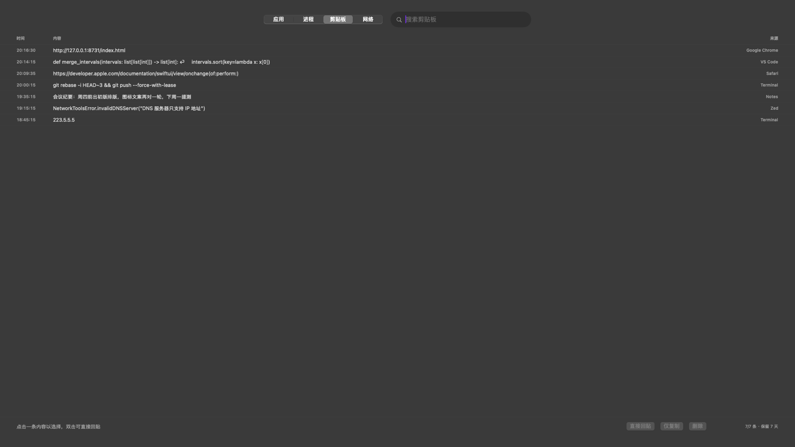
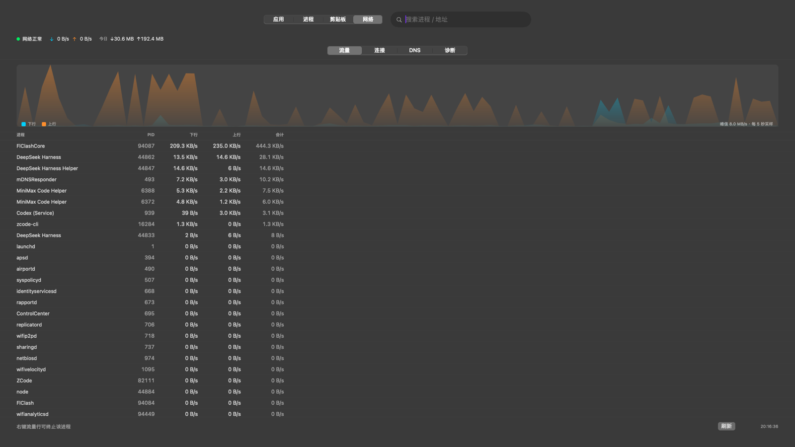
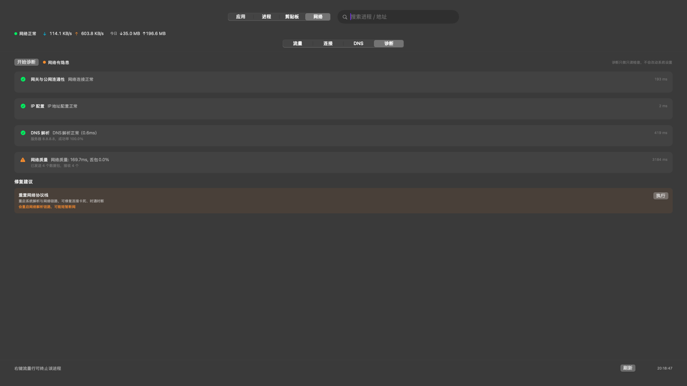

# LaunchGrid

用熟悉的图标启动 Mac 应用，快速查看它的运行与联网状态。支持全屏网格和可缩放窗口，也能整理文件夹、按拼音搜索。

[下载最新版](https://github.com/CacinieP/launchgrid/releases/latest) · [English](README.en.md) · [0.4.2 更新说明](doc/releases/0.4.2.md) · [使用反馈](https://github.com/CacinieP/launchgrid/issues/new/choose)

## 下载与要求

- **macOS 26 或更新版本**，支持 Apple Silicon 和 Intel。
- 从 [GitHub Releases](https://github.com/CacinieP/launchgrid/releases/latest) 下载 DMG，拖入 **Applications（应用程序）** 后打开。正式发行包使用 Developer ID 签名与 Apple 公证；具体版本和资产以发行页为准。
- LaunchGrid 常驻菜单栏，没有 Dock 图标。菜单栏图标提供面板入口、设置和退出操作。

## 第一次使用

1. 按 **F4** 打开应用网格；部分键盘需要同时按 **fn**。无反应时，从菜单栏进入「设置…」更换快捷键，查看冲突提示。
2. 输入应用名、中文拼音、首字母或别名。按 **↓** 进入网格，再用方向键选择、**回车**打开；**Esc** 收起。
3. 拖动图标排序，右键创建文件夹、移入或移出应用。右上「布局」菜单可备份、恢复布局。
4. 右键应用 →「查看运行与联网状态…」，查看 CPU、内存、相关进程和可见连接，或请求正常退出。

菜单栏可切换默认全屏/窗口模式；**⌘F4** 直接打开窗口模式。窗口位置与大小会记住，关闭窗口后仍可从菜单栏呼出。登录时启动和所有快捷键都可在设置中调整。

## 主要能力

| 面板 | 默认快捷键 | 用途 |
|---|---|---|
| 应用 | F4 | 搜索启动、拖放排序、单层文件夹、别名、布局备份/恢复 |
| 进程 | ⌥F4 | 查看 CPU/内存，搜索进程与 PID，正常终止或强制终止 |
| 剪贴板 | ⇧F4 | 可选文本历史、搜索、仅复制或直接回贴 |
| 网络 | ⇧⌥F4 | 查看速率与连接，检查 DNS，按需诊断与修复 |

应用安装或移除后，列表会自动更新。旧 Launchpad 布局导入需要仍可读取、结构受支持的 Apple 数据库，只匹配已安装的应用；系统已删除的数据库无法恢复。文件夹仅支持一层，剪贴板不记录图片或文件。

| 进程 | 剪贴板 |
|---|---|
|  |  |

| 网络流量 | 网络诊断 |
|---|---|
|  |  |

## 模块、隐私与权限

**剪贴板新安装默认关闭。** 开启后会在后台记录新复制的纯文本；可随时关闭、暂停、忽略指定应用或确认清空。暂停/关闭期间的文本不会在恢复时补录。检测到旧版历史的升级用户延续原开启状态，设置中会显示说明。

历史仅在本机以**未加密的 JSON 明文**保存，文件权限为 `0600`，保留 7 天、最多 200 条。来源按前台应用估计；忽略某个应用也会移除其已有匹配记录。仅能跳过来源应用主动标记的敏感内容，不能保证识别所有秘密。关闭采集不会自动清空已有历史。

**网络模块可关闭。** 常规采样仅在网络面板或应用详情可见时运行；隐藏/关闭期间的流量不计入累计。连接可见范围受 macOS 权限限制，CPU 为系统平均值。手动 DNS 探测和诊断会发送真实网络请求；修改 DNS 或执行修复前会说明影响，需要时由系统请求管理员授权。

打开应用与全局快捷键不需要辅助功能权限；**直接回贴**需要在「系统设置 → 隐私与安全性 → 辅助功能」授权。未授权时仍可「仅复制」，再自行粘贴。

## 更新

设置中默认开启每日正式版检查，可关闭或手动检查。检查会访问 GitHub；**下载和安装需要单独点击**。

安装在可写的 `/Applications` 或 `~/Applications` 时，可在应用内校验并安装新版，再选择重启。其他位置或不满足校验条件时，请从 [发行页](https://github.com/CacinieP/launchgrid/releases/latest) 手动安装。更新器不提供新版启动失败后的自动回滚。

## 反馈与参与

请到 [Issues](https://github.com/CacinieP/launchgrid/issues/new/choose) 提交问题或建议，附应用版本、macOS 版本和复现步骤；请勿上传剪贴板内容、凭据或完整连接记录。[一周试用清单](doc/USER_TESTING.md) 可用于记录实际体验。

开发资料移至 **[doc/](doc/README.md)**：[开发与调试](doc/development.md) · [架构](doc/architecture.md) · [技术取舍](doc/decisions.md) · [打包与发布](doc/releasing.md)。

## 许可证

自 **0.4.2** 起采用 **AGPL-3.0-only**，完整条文见 [LICENSE](LICENSE)。Copyright © 2026 CacinieP。历史版本保留各自 tag/commit 的许可证记录。

App 附带完整许可证和该构建对应的源码链接，Release 提供对应源码包；设置 → 关于提供源码与许可证入口。
