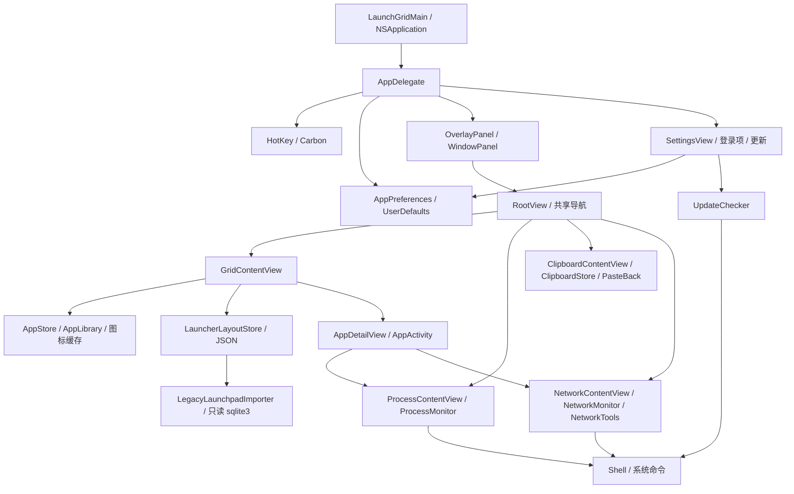

# 架构

[文档目录](README.md) · [开发与调试](development.md) · [技术取舍](decisions.md)

LaunchGrid 是一个进程内的原生 macOS 菜单栏 App：SwiftUI 负责内容，AppKit 管理状态栏、全屏 NSPanel、标准 NSWindow 与系统交互。没有独立后台 daemon、远端账户服务或第三方 package 依赖。

## 模块关系

两个界面外壳共享 model 和导航，但各自承载 RootView，不是两个后台采集实例。AppDelegate 决定当前显示形态、面板和详情是否可见，并统一驱动按需采样。

## 数据流

| 场景 | 输入 → 处理 → 输出 |
|---|---|
| 应用清单 | 应用目录/目录事件 → 递归扫描、路径去重、名称排序、图标缓存失效 → `AppStore.apps` → 网格 |
| 整理与搜索 | 安装清单 + 已存布局/别名 → 校验、保留存活位置、补充新 App → 网格顺序；名称/拼音/首字母/别名 → 搜索结果 |
| 布局导入 | 用户选择 JSON 或旧数据库 → 大小/版本/结构校验、后台只读解析 → 匹配已安装 App → 原子保存与更新布局 |
| 单应用详情 | App 包路径 → 路径内进程及其后代 PID → CPU/内存合计，按 PID 筛选流量和连接 |
| 剪贴板 | opt-in + 未暂停 + 新 `changeCount` → 隐藏类型/来源/大小过滤 → 去重、限额、保留清理 → Published 列表与串行 JSON 保存 |
| 直接回贴 | 已选文本 + 呼出前目标 → 写系统剪贴板、收起界面、激活目标 → 确认前台目标后发送 ⌘V |
| 网络流量 | 默认接口计数器/单调时钟、nettop、lsof → 差分/解析/PID 归属 → 可见界面；定时增量 → JSONL 与日缓存 |
| 更新 | GitHub 正式版元数据 → 版本/资产 URL/digest → 用户点击下载 → 摘要、App身份与签名校验 → 暂存替换 → 用户选择重启 |

清单路径是应用身份基础，PID 是某次运行实例的归属基础；不依赖 nettop/lsof 被截断的名字匹配不同应用。独立进程与跨应用服务未必属于某个包，详情不承诺完整追踪所有系统代理。

## 生命周期

1. **启动**：建立共享模型，扫描应用并监听目录，建立状态栏，载入剪贴板历史并按偏好决定是否监听，注册五组热键，读取登录项状态，按偏好/上次时间决定更新检查。
2. **显示**：全屏/窗口互斥；呼出前记录回贴目标，恢复同一份应用/模块状态。按可见面板或详情需要启动进程、网络采样。
3. **切换/隐藏**：切换清空搜索、结束详情；收起停止进程/网络定时器并重置详情状态。网络使用 generation 与锁丢弃旧采样结果，重建差分基线，停用期间流量不累计。
4. **剪贴板独立开关**：启用时跨界面隐藏继续收集；关闭/暂停取消轮询，恢复跳过当前剪贴板。保留的已有记录仍可查看/清空。新安装默认关闭；检测到旧历史的首次迁移保留原行为并展示说明。
5. **退出**：停止监听、注销热键、停采样，剪贴板等待已排队保存完成。关闭标准窗口只是隐藏，菜单栏 App 仍运行。

可见性控制避免常驻 `ps` / `nettop` 轮询，但不是取消所有已经启动的系统命令的强制沙箱。DNS/诊断等由用户发起的任务有各自异步和超时路径。

## 权限与外部访问

| 能力 | 权限/访问范围 | 边界 |
|---|---|---|
| 启动 App、应用网格、Carbon 热键 | 普通用户，无辅助功能授权 | 系统或其他 App 已占用的热键可能注册失败，设置保留旧值并提示 |
| 进程/连接读取 | 普通用户可见的系统数据 | 其他用户和受保护进程可能不可见，操作可能被拒绝；无须为基础使用授予完全磁盘访问 |
| 直接回贴 | 用户授予辅助功能 | 发送合成 ⌘V；未授权可仅复制，目标已退出/前台改变时不继续投递 |
| 剪贴板历史 | 用户在 App 中明确开启 | 标记过滤依赖来源 App，来源按前台 App 估计，不是系统提供的可信 owner |
| DNS 与网络修复 | 可能需要系统管理员授权 | 会改变当前网络配置并可能中断连接；界面确认后执行，不自动修复 |
| DNS 探测/诊断 | 向 DNS 服务器/测试目标真实发包 | 与常规本地计数器采样不同；域名对所用 DNS 服务器可见 |
| 更新检查/下载 | GitHub API 与 GitHub 发行资产/CDN | 默认每日检查可关闭，安装另需点击；本地签名/Gatekeeper 校验后替换可写安装 |
| 登录时启动 | `SMAppService.mainApp` | 状态由 macOS 管理，可能要求用户在系统设置批准 |

App 没有启用 App Sandbox，以便调用系统工具和网络设置通路。普通命令用数组传参；需要提权时存在受控 shell/AppleScript 通路，输入约束是实现的一部分。

## 本地存储

应用支持目录基准为 `~/Library/Application Support/LaunchGrid/`。

| 数据 | 路径/位置 | 保留与恢复 |
|---|---|---|
| 网格顺序/文件夹/别名 | `launcher-layout.json` | version 1；导入上限 5 MB；按安装清单同步。损坏文件尽可能改名隔离并保留通知，无法隔离时停止持久化以保留原文件 |
| 布局损坏备份/提示 | `launcher-layout.corrupt-<UUID>.json`、`launcher-layout.json.recovery-notice.txt` | 提示确认后清除提示文件；隔离文件不自动覆盖 |
| 剪贴板 | `clipboard.json` | 未加密 JSON，写后权限 0600；7 天/200 条/256 KiB 每条；串行原子写，删除立即排队，退出等写完 |
| 网络历史 | `network/traffic-YYYY-MM-DD.jsonl` | 约 5 秒增量追加；网络面板出现时清理超过 45 天文件；日/周/月按采样时段累加 |
| 偏好与窗口 | `UserDefaults`，发行 bundle ID `app.caciniep.launchgrid` | 热键、模块开关、忽略名单、更新检查时间、呈现方式、窗口位置等；登录项注册由系统管理 |
| 调试日志 | `/tmp/launchgrid-debug.log` | Debug 默认开，Release 默认关；无自动轮转 |
| 截图 | `LAUNCHGRID_SNAPSHOT_PATH` 指定位置 | 仅显式调试生成，由操作者管理 |
| 更新暂存 | 系统临时目录与安装目录中随机 stage `.app` | 只读挂载 DMG，验证后替换，清理暂存；不保留启动失败自动回滚副本 |

剪贴板在载入、显示面板与启用采集期间按日清理。关闭/暂停/退出时不承诺有独立常驻服务持续擦除已经到期的磁盘数据；再次载入/清理后过滤过期条目。网络历史同样由使用时的清理触发，而非系统定时任务。应用不提供历史云同步或自动用户反馈上传。

## 布局与更新的失败边界

布局 JSON 只含路径与显示数据，不含要执行的脚本。导入失败保留当前布局；只读旧库导入使用系统 sqlite3 的 safe/readonly 模式、禁止 trusted schema，限制文件/行数/输出/超时，不修改或重建系统数据库。文件夹只保留一层，导入嵌套组采用可表达的单层映射。

更新依次校验：正式版/数字版本 → 官方仓库与标签的精确 DMG URL → GitHub SHA-256 → App bundle ID/版本 → deep/strict codesign、固定 Developer ID Team、Gatekeeper → ditto 暂存后再验签 → Foundation 替换。校验或暂存失败时不会先主动删除旧 App；安装成功后由用户决定重启，不提供新版本无法启动时的自动回滚。
